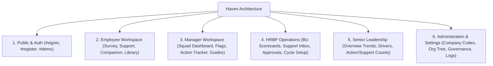
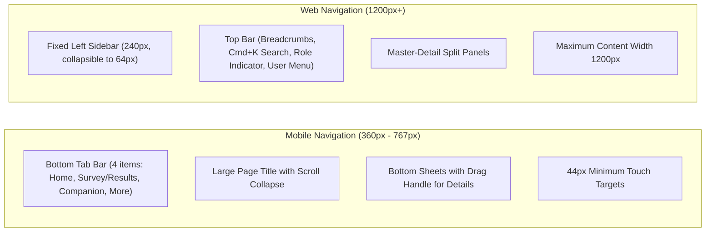

# Haven: Information Architecture & Navigation Map (docs/IA.md)

---

## 1. Top-Level Section Taxonomy
All capabilities across Haven are structured into **six core sections**:

---

## 2. Comprehensive Inventory, Depths & Usage Frequency

| Item / Feature | Primary Section | Hierarchy Depth | Usage Frequency | Description |
|---|---|---|---|---|
| **Public Landing Page** | Public | Level 1 | Initial entry | Value proposition, mechanism breakdown, interactive preview |
| **Auth Panel Modal / Sheet** | Public | Level 1 | Per-session | Segmented control: Sign In, Register, Demo mode |
| **Demo Dataset Picker** | Public / Demo | Level 1 | Frequent in demo | 12 distinct corporate scenarios with one-click entry |
| **Employee Home** | Employee | Level 1 | Daily/Weekly | Calm dashboard with 3 primary action cards & request status |
| **Anonymous Micro-Survey** | Employee | Level 1 | Per cycle | 6 core dimensions + 4 check-in questions, < 4 mins, skippable |
| **Confidential Support Request** | Employee | Level 2 | As needed | Form with support type, urgency, anonymous toggle; routes to HRBP |
| **Support Request Status & Chat** | Employee | Level 2 | Ongoing | View assigned HRBP, withdraw request, append message |
| **Wellbeing Companion Hub** | Employee | Level 1 | Daily/Weekly | Chat interface with crisis safeguard (Tele-MANAS) |
| **Voice Bots & Guides Catalog** | Employee | Level 2 | Occasional | Catalog of 5 persona guides with filter chips and search |
| **Voice Bot Detail Panel** | Employee | Level 3 | Rare | Tabs: Overview, Voice/Language, Behavior, Usage, Advanced |
| **Self-Help Resource Library** | Employee | Level 2 | Weekly | Breathing exercises, mindfulness audio, decompression guides |
| **Manager Team Dashboard** | Manager | Level 1 | Weekly | 6 domain scorebars, participation rate, quarterly delta |
| **Calibrated Friction Flags** | Manager | Level 1 | Per cycle | Workload & safety triggers with recommended playbook |
| **14-Day Action Commitment** | Manager | Level 2 | Per cycle | Concrete process reform logging with status tracking |
| **Section 18 Privacy Shield** | Manager | Level 1 | Automatic | Calm lock panel replacing all metrics if $N < 5$ |
| **AI Comment Theme Summary** | Manager | Level 3 (Opt-in) | Rare | Synthesizes themes if $N \ge 10$ and comments $\ge 5$; zero quotes |
| **Manager Conduct Guide** | Manager | Level 2 | Periodic | Guidelines: listen more than speak, never seek low raters |
| **Stay-Interview Guide** | Manager | Level 2 | Periodic | Structured retention dialogue playbook |
| **HRBP All-Squads Scorecard** | HRBP | Level 1 | Weekly | 10-squad diagnostic table with sorting & density toggle |
| **Safe CSV Export** | HRBP | Level 2 | Per cycle | Downloadable CSV strictly excluding groups with $N < 5$ |
| **Support Request Triage Inbox** | HRBP | Level 1 | Daily | Triage, assign, reply to, and close confidential requests |
| **Elevated Role Approvals** | HRBP / Admin | Level 2 | As needed | Approve/reject Manager, HRBP, and Leadership role requests |
| **Survey Cycle Management** | HRBP / Admin | Level 2 | Quarterly | Launch cycles, set close dates, dispatch anonymous reminders |
| **Manager Follow-Through Table**| HRBP | Level 2 | Bi-weekly | Track 14-day action compliance & stay interviews without scores |
| **Leadership Org Overview** | Leadership | Level 1 | Monthly | High-level trends, participation rate, unit roll-ups |
| **Leadership Drivers View** | Leadership | Level 1 | Monthly | Deep dive into 6 drivers over time with limitations callouts |
| **Leadership Actions & Support** | Leadership | Level 1 | Monthly | Open/closed action metrics and support request volume |
| **Printable Executive Brief** | Leadership | Level 2 | Quarterly | Clean printable summary for executive/board presentations |
| **Company Code Management** | Admin | Level 2 | Periodic | Generate, rotate, expire, or revoke join codes |
| **Org Structure Editor** | Admin | Level 2 | Periodic | Add and configure Business Units, Teams, and Headcount |
| **Privacy & Retention Settings**| Admin | Level 2 | Rare | Min group size (5+), 90-day raw data retention job |
| **AI Governance & Kill-Switch** | Admin | Level 2 | Rare | Instant kill-switch for comment synthesis and companion |
| **Immutable Audit Trail** | Admin | Level 3 | As needed | Append-only log of result views, exports, and approvals |

---

## 3. Wellbeing Companion & Voice Bot Catalog

The Companion Chat architecture integrates 5 curated persona guides:

| Bot Name | Persona / Focus | Supported Languages | Voice Profile | Default Status |
|---|---|---|---|---|
| **Aarav** | Grounding & Acute Stress Relief | English, Hindi (हिन्दी) | Calm, low-pitch, slow cadence | Active |
| **Maya** | Workload Reflection & Boundaries | English | Warm, reflective, paced | Active |
| **Priya** | Sleep Hygiene & Decompression | English, Kannada (ಕನ್ನಡ) | Soothing, gentle, whispered | Active |
| **Kabir** | Dialogue & Manager Conversation Prep | English | Structured, coaching, encouraging | Active |
| **Ananya**| Mid-Day Reset & Micro-Breaks | English, Hindi (हिन्दी) | Energizing calm, crisp | Active |

### Bot Detail Panel Architecture (Side Drawer / Bottom Sheet)
- **Tab 1: Overview**: Bio, target scenarios, crisis safety disclaimer.
- **Tab 2: Voice & Language**: Supported languages, audio sample playback button, speech rate.
- **Tab 3: Behavior**: Conversation boundary rules, suggested prompts, reflection style.
- **Tab 4: Usage**: Personal session count, last interaction timestamp (private to user).
- **Tab 5: Advanced**: Session reset, private history purge.

---

## 4. Multi-Device Navigation Model

---

## 5. Settings Index & Grouping

Organized into 6 clean functional clusters:
1. **Account**: Profile name, work email, verified badge, session sign out.
2. **Company & Role**: Active company name, company code status, team assignment, role status.
3. **Notifications**: Survey cycle alerts, support request replies (in-app only).
4. **Privacy & Anonymity**: Minimum threshold indicator ($N \ge 5$), Section 18 invariants, chat history retention toggle.
5. **Appearance**: Manual Theme Toggle (Calm Light `#FAFAF8` vs Calm Dark `#0E0F11`), Reduced Motion toggle.
6. **Advanced (Admin/Governance)**: AI Feature Kill-Switch, Gemini model selection, 90-day retention status.
