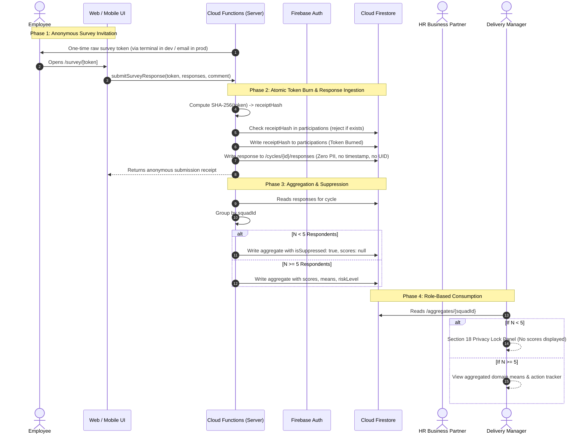

# Haven: Privacy Data Flow Specification (docs/PRIVACY_DATA_FLOW.md)

This document specifies the privacy architecture, data tokenization lifecycles, and cryptographic guarantees governing employee sentiment and wellbeing telemetry in Haven.

---

## 1. End-to-End Survey Data Flow



---

## 2. Core Privacy Invariants

### Invariant 1: Client Read Access Revocation on Raw Responses
- Firestore Security Rules enforce:
  ```javascript
  match /companies/{companyId}/cycles/{cycleId}/responses/{responseId} {
    allow read, write: if false;
  }
  ```
- No user role, not even `company_admin` or `senior_leadership`, can query or view raw survey response documents from the client SDK. Only backend Cloud Functions using the Firebase Admin SDK can compute aggregates.

### Invariant 2: Cryptographic Token Separation
- Survey invite links contain a cryptographically secure 32-byte token.
- The raw token is **never stored in plaintext** in Firestore.
- Upon submission, the server computes a one-way `SHA-256` hash of the token.
- The hash is inserted into `/participations/{receiptHash}` in an atomic transaction.
- If a hash is already present, submission is rejected with an uninformative error (`TOKEN_ALREADY_USED`), preventing replay attacks.
- There is **no foreign key, column, or link** connecting the participation receipt to the response document.

### Invariant 3: Minimum Group Suppression ($N \ge 5$)
- Aggregates are computed strictly at the squad level.
- If a squad has fewer than 5 respondents ($N < 5$), the server sets:
  - `isSuppressed: true`
  - `overallScore: null`
  - `items: []`
  - `comments: []`
- The manager and leadership dashboards display a calm Section 18 privacy lock panel rather than partial scores.

### Invariant 4: Differencing Protection (Sub-Team Deltas)
- If an organizational hierarchy contains sub-teams where subtracting a sub-team's count from the parent unit would isolate a cohort of fewer than 5 respondents ($N_{parent} - N_{sub1} < 5$), complementary suppression is enforced so that individual responses cannot be derived mathematically.

### Invariant 5: Firewalled Wellbeing Support Requests
- Support tickets submitted by employees:
  - Are stored in `/companies/{companyId}/support_requests/{requestId}`.
  - Are readable **only** by the creating employee (`auth.uid == resource.data.employeeUid`) and approved HR Business Partners (`isRole('hrbp')`).
  - Delivery managers and senior executives are blocked at the database engine level via security rules.

### Invariant 6: 100% Private Companion Chat Sessions
- AI Companion chat sessions are stored at `/users/{userId}/companion_sessions/{sessionId}`.
- Governed by:
  ```javascript
  allow read, write: if request.auth.uid == userId;
  ```
- No company administrator, HRBP, or manager can read employee companion chat sessions.

### Invariant 7: Automated 90-Day Raw Data Purge
- A scheduled Cloud Function (`retentionPurge`) executes every 24 hours.
- For survey cycles closed longer than 90 days, all raw responses and participation tokens are permanently deleted from Firestore. Aggregated summary statistics remain preserved.
