# Pulse Application Route Architecture & Layout Hierarchy

This document provides the authoritative mapping of routes, layouts, and access rules for the Pulse application.

---

## 1. Route Hierarchy Diagram

```mermaid
graph TD
  Root["RootLayout (app/layout.tsx)<br/>• ThemeProvider<br/>• AuthProvider<br/>• ToastProvider<br/>• AuthModal<br/>• Fonts: Inter, Mono, Source Serif 4"]
  
  Root --> Marketing["(marketing) Route Group<br/>Layout: app/(marketing)/layout.tsx<br/>• LandingNav (Header)<br/>• LandingFooter (Footer)<br/>• Document-level body scroll"]
  Root --> AppGroup["(app) Route Group<br/>Layout: app/(app)/layout.tsx<br/>• Exactly ONE AppShell<br/>• Fixed Sidebar (w=245px)<br/>• Fixed TopBar (h=48px)<br/>• Scrollable #main-content"]
  Root --> DevGroup["dev Route Group<br/>Layout: app/dev/layout.tsx<br/>• Minimal Dev Navigation Bar<br/>• Document-level body scroll<br/>• No AppShell double-nesting"]
  Root --> Standalone["Standalone Routes<br/>• /login<br/>• /survey/[token]"]

  Marketing --> Home["/ (Home Landing Page)"]
  Marketing --> Privacy["/privacy (Data Flow & Privacy Policy)"]
  Marketing --> Terms["/terms (Terms & Non-Retaliation Charter)"]
  Marketing --> About["/about (Research Foundations)"]
  Marketing --> NotFound["/_not-found (404 Page)"]

  AppGroup --> DashEmployee["/dashboard/employee (Employee Sanctuary)"]
  AppGroup --> DashManager["/dashboard/manager (Delivery Manager)"]
  AppGroup --> DashHR["/dashboard/hr (HRBP Operations & Triage)"]
  AppGroup --> DashDirector["/dashboard/director (Leadership Scorecard)"]
  AppGroup --> DashAdmin["/dashboard/admin (Company Admin & IAM)"]
  AppGroup --> DashCompanion["/dashboard/companion (Companion Bot Catalog)"]
  AppGroup --> LibStay["/library/stay-interview"]
  AppGroup --> LibConduct["/library/conduct-guide"]
  AppGroup --> LibPilot["/library/pilot-plan"]
  AppGroup --> LibSkip["/library/skip-level-guide"]

  DevGroup --> DevBrand["/dev/brand (Brand Identity Spec)"]
  DevGroup --> DevComponents["/dev/components (UI Primitives)"]
  DevGroup --> DevMotion["/dev/motion (Motion Tokens)"]
```

---

## 2. Route Groups & Layout Responsibilities

### A. Root Layout (`src/app/layout.tsx`)
- **Chrome:** Absolutely **zero** visible application chrome (no sidebar, no top bar, no headers, no footers).
- **Providers:**
  - `ThemeProvider`: Context provider for dark/light theme switching.
  - `AuthProvider`: Context provider for authentication state (signed-out, real, demo).
  - `ToastProvider`: Enterprise toast notification manager.
  - `AuthModal`: Accessible modal dialog for Sign In, Registration, and Demo Persona Selection.
- **Typography:** Injects CSS variables for `--font-inter` (Inter), `--font-mono` (IBM Plex Mono), and `--font-serif` (Source Serif 4).
- **Body Styling:** `min-h-screen font-sans antialiased bg-theme-bg text-theme-primary`.
- **Accessibility:** Houses the `#main-content` skip link.

### B. Marketing Route Group (`src/app/(marketing)/layout.tsx`)
- **Scope:** Public marketing pages (`/`, `/privacy`, `/terms`, `/about`, `not-found`).
- **Chrome:**
  - `LandingNav`: Translucent fixed header with brand lockup ($\ge 32$px mark), section links, theme toggle, and CTA buttons.
  - `LandingFooter`: Navy band (`#03173B`) with horizontal lockup, statutory privacy notice, legal links, and Tele-MANAS crisis safety numbers.
- **Scrolling:** Native document-level body scroll (`overflow-y: auto` at window level, no `overflow: hidden` wrappers).

### C. Application Route Group (`src/app/(app)/layout.tsx`)
- **Scope:** Protected operational dashboards and internal governance library.
- **Chrome:** Renders **exactly one** `<AppShell>` instance:
  - `RouteLoadingBar`: Slim top accent line indicating route progress.
  - `CommandPalette`: Accessible $\text{\textsf{Cmd+K}}$ global action launcher.
  - `ShortcutsModal`: Keyboard shortcut guide ($\text{?}$).
  - `Sidebar`: 245px fixed navy sidebar (collapsible to 60px) with brand mark ($\ge 28$px), section navigation, and active indicators.
  - `TopBar`: 48px header with dynamic breadcrumbs, demo mode indicator, notifications popover, theme toggle, and user profile menu.
  - `#main-content`: Scrollable content viewport (`overflow-y: auto`, `p-4 md:p-6`).
- **Rule:** Page components inside `(app)` **must never** render `<AppShell>` internally.

### D. Developer Route Group (`src/app/dev/layout.tsx`)
- **Scope:** Technical documentation, brand design specifications, and primitive catalogs.
- **Chrome:** Minimal 48px navigation header with direct tab switching between `/dev/brand`, `/dev/components`, and `/dev/motion`, plus a "Return to Workspace" link.
- **Scrolling:** Unrestricted document-level scrolling.

---

## 3. Complete Route Table

| Route Path | Route Group | Layout | Auth Requirement | Description |
| :--- | :--- | :--- | :--- | :--- |
| `/` | `(marketing)` | Marketing Layout | Public | Landing page with hero navy band, motif, live preview, 8 truthful sections. |
| `/privacy` | `(marketing)` | Marketing Layout | Public | Privacy policy, token detachment, $N \ge 5$ suppression, 90-day retention. |
| `/terms` | `(marketing)` | Marketing Layout | Public | Terms of service, mandatory Non-Retaliation Charter, acceptable use. |
| `/about` | `(marketing)` | Marketing Layout | Public | Psychological safety and engagement theoretical foundations (Edmondson, Kahn). |
| `/dashboard/employee` | `(app)` | Single AppShell | Employee / Demo | Confidential sanctuary, check-ins, breathing exercise, support requests. |
| `/dashboard/manager` | `(app)` | Single AppShell | Manager / Demo | Squad diagnostic telemetry, $N < 5$ shield, 14-day process action commitments. |
| `/dashboard/hr` | `(app)` | Single AppShell | HRBP / Demo | Multi-squad scorecard, safe CSV export ($N \ge 5$), support triage inbox. |
| `/dashboard/director` | `(app)` | Single AppShell | Leadership / Demo | Executive scorecard, non-league squad distribution, retention risk indices. |
| `/dashboard/admin` | `(app)` | Single AppShell | Admin / Demo | Tenant governance, cycle scheduling, IAM approval queue, immutable audit logs. |
| `/dashboard/companion` | `(app)` | Single AppShell | Member / Demo | 24/7 AI Companion Bot catalog (Aarav, Priya, Kabir, Ananya, Vikram). |
| `/library/stay-interview` | `(app)` | Single AppShell | Authenticated | Structured stay interview protocol and non-punitive manager guidelines. |
| `/library/conduct-guide` | `(app)` | Single AppShell | Authenticated | Code of conduct and zero-tolerance non-retaliation enforcement policy. |
| `/library/pilot-plan` | `(app)` | Single AppShell | Authenticated | 90-day implementation roadmap and milestone progression schedule. |
| `/library/skip-level-guide` | `(app)` | Single AppShell | Authenticated | Skip-level meeting framework for engineering leadership. |
| `/dev/brand` | `dev` | Dev Layout | Public / Dev | Brand kit inspection, sampled hex swatches, vector lockups, WCAG AA matrix. |
| `/dev/components` | `dev` | Dev Layout | Public / Dev | Enterprise design system primitives (KPI tiles, DataTables, Drawers, Badges). |
| `/dev/motion` | `dev` | Dev Layout | Public / Dev | Motion system tokens, timing curves, and animated primitives. |
| `/login` | Standalone | Root Only | Public | Corporate email sign-in and SSO gateway. |
| `/survey/[token]` | Standalone | Root Only | Token-gated | Single-use confidential survey questionnaire with burned token confirmation. |

---

## 4. Verification Guarantees

1. **Zero Shell on Public Pages:** Public routes (`/`, `/privacy`, `/terms`, `/about`) contain 0 `<AppShell>` elements in the DOM.
2. **Single Shell on App Pages:** All routes under `src/app/(app)/` contain exactly 1 `<AppShell>` and 1 `<Sidebar>`.
3. **Automated Assertion:** Enforced via Playwright end-to-end tests (`tests/e2e/demo-and-navigation.spec.ts`) and Vitest layout structure tests (`tests/route-groups-and-layout.test.ts`).
